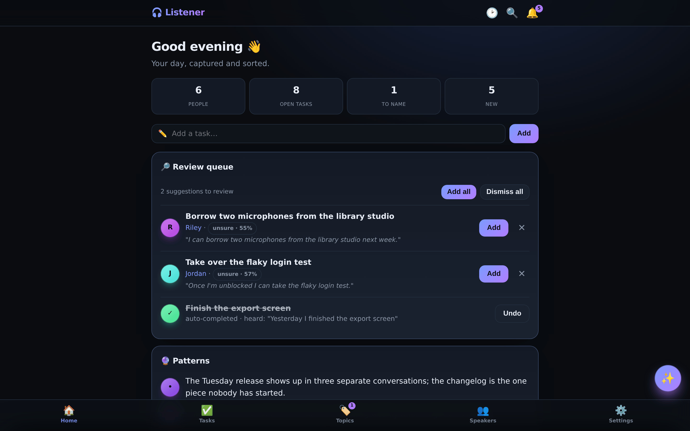
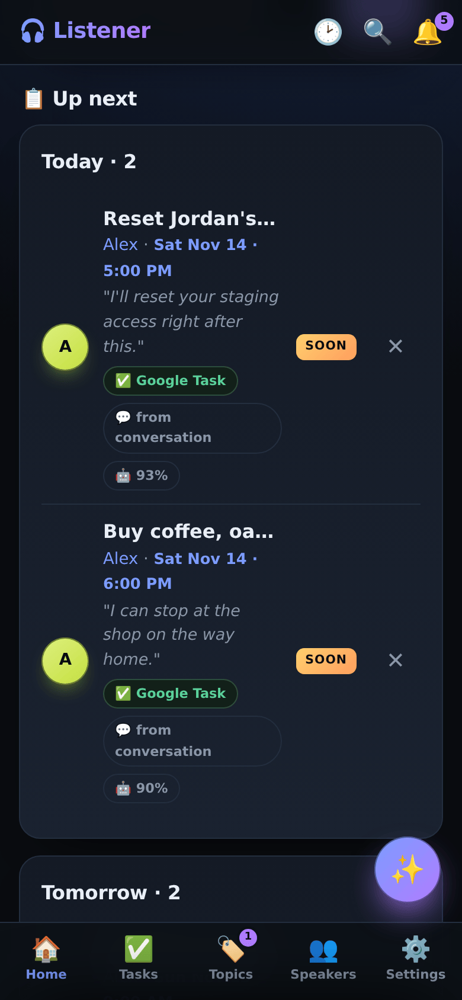
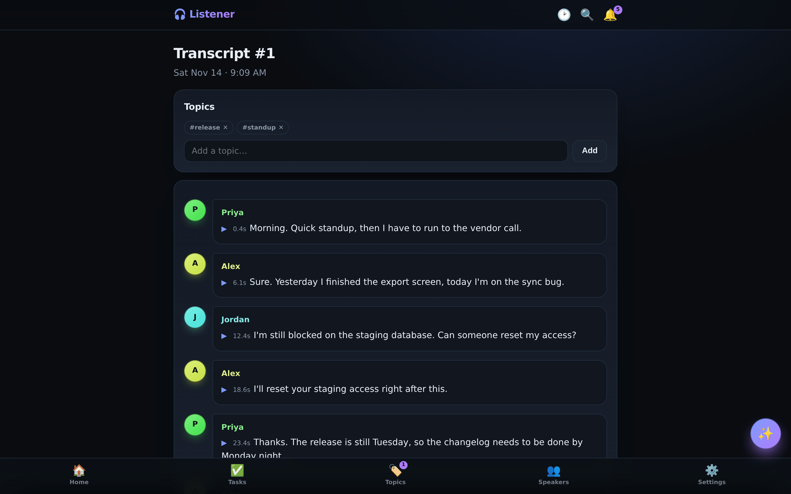
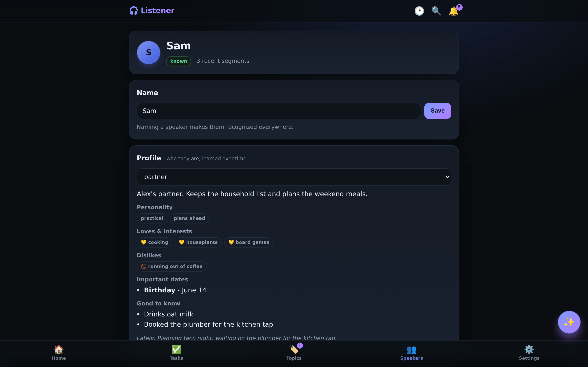
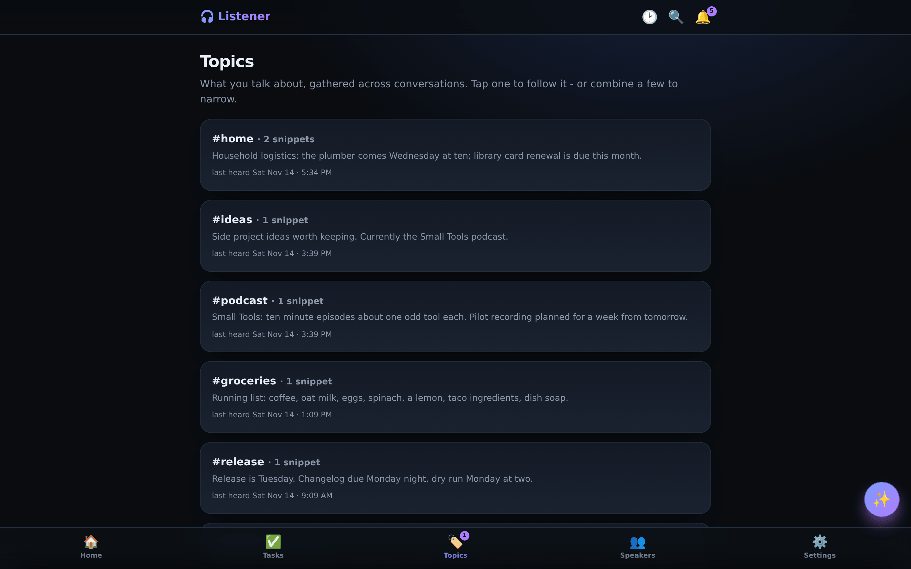
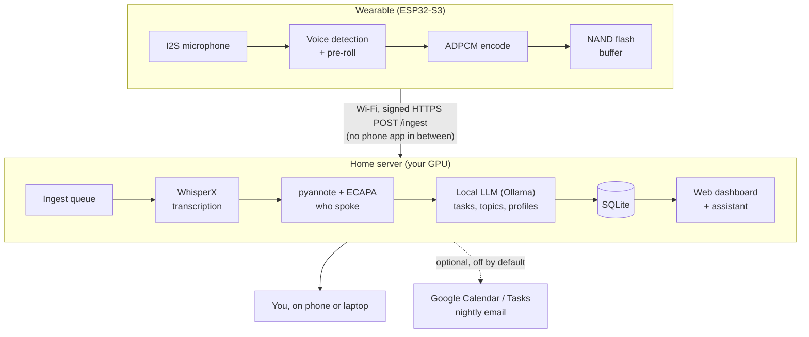

<div align="center">


# Listener

**An all-day audio wearable that turns what you say into tasks and notes, processed on your own home server.**

[](https://github.com/jbarnell1/listener/actions/workflows/ci.yml)
[](LICENSE)
[](https://github.com/jbarnell1/listener/stargazers)
[](https://github.com/jbarnell1/listener/commits/main)


&nbsp;


<sub>Screenshots show invented demo data (<code>homelab/demo_seed.py</code>), never real recordings.</sub>

</div>

## What it is

Listener is a DIY wearable built on an ESP32-S3. It listens all day, keeps only the parts that
contain speech, and uploads them to a computer in your home. That computer transcribes the
audio with Whisper, works out who was speaking, and uses a local LLM to pull out tasks, events
and follow-ups, which you review on a small web dashboard.

It is for people who like the idea of an "AI memory" pendant but do not want a company holding
a recording of their day. Speech recognition, speaker identification and the LLM all run on
your own GPU. The few things that can leave your home are optional and listed below.

This is a personal project used by one household, not a product. Expect rough edges.

## Features

- **Hands-free capture.** On-device voice detection with a pre-roll buffer, so the start of a
  sentence is not clipped. A REC button marks something as important; a MODE button mutes.
- **Works away from Wi-Fi.** Audio is compressed (IMA ADPCM) into on-board flash and uploaded
  in batches when a known network is in range. The radio stays off in between to save battery.
- **Speaker-attributed transcripts.** WhisperX word timings plus pyannote diarization and ECAPA
  voiceprints. Name a voice once and it is recognised afterwards.
- **Tasks, events and follow-ups from conversation.** A local LLM extracts them with a
  confidence score. Unsure items wait in a review queue instead of cluttering your list.
- **It notices when things get done.** Hearing "I finished the export screen" closes the
  matching task, with an undo.
- **Topics, search and a timeline.** Conversations are tagged, each topic keeps a running
  summary, and everything spoken is searchable and exportable.
- **People profiles with an off switch.** What it learns about someone can be edited, turned
  off per person, or deleted along with their voiceprint and their lines.
- **A local assistant.** Ask "what did we decide about the release?" in the dashboard. It runs
  on Ollama and reaches your data through an MCP server on localhost.
- **Shares the GPU politely.** Heavy work pauses while the GPU is busy (for example a game) and
  catches up later.

<div align="center">



</div>

## How it works



1. **Wearable.** The board samples a digital microphone continuously. When it hears speech it
   writes compressed audio to on-board NAND flash. Steady noise (fans, road noise) is dropped
   on the device.
2. **Sync.** About every 30 minutes, or straight away after a REC press, the board switches
   Wi-Fi on, posts its buffered chunks to the server and switches Wi-Fi off. Each request is
   signed with a per-device HMAC key. There is no phone app: at home the board talks to the
   server directly, and away from home it can use a phone hotspot and a public HTTPS address
   that exposes only the upload endpoints.
3. **Transcription.** A worker on the server drains the queue: ffmpeg, WhisperX (faster-whisper
   `large-v3` plus forced alignment), pyannote diarization and ECAPA speaker identification.
4. **LLM pass.** A model served by Ollama (default `qwen3:8b`) extracts tasks and events, tags
   topics, updates people profiles and writes a short nightly "patterns" reflection.
5. **Dashboard.** A FastAPI and HTMX web app, installable on a phone as a PWA.

The full design is in [`docs/ARCHITECTURE.md`](docs/ARCHITECTURE.md).

## Hardware you need

**For the wearable** (details and LCSC part numbers in
[`docs/hardware/BOM.md`](docs/hardware/BOM.md)):

| Part | Role |
|---|---|
| ESP32-S3-WROOM-1U-N16R8 module + U.FL antenna | MCU, Wi-Fi, 8 MB PSRAM for the pre-roll buffer |
| Winbond W25N01GV 1 Gbit SPI NAND | offline audio buffer |
| INMP441 I2S microphone breakout | audio in |
| TP4056 charger, AO3401A MOSFET, AP2112K 3.3 V regulator | USB-C charging and power path |
| 3000 mAh single-cell LiPo (407090) | battery |
| USB-C socket, USBLC6-2SC6, 4 tactile switches, 4 LEDs, 0603 passives | I/O and protection |

The board is a 2-layer, 87 x 65 mm design made in EasyEDA Pro and fabricated at JLCPCB.

> **What is and is not in this repo.** The pinout, the bill of materials, and section by
> section schematic and layout notes are in [`docs/hardware/`](docs/hardware/). The EasyEDA
> project, Gerbers, an enclosure and photos of the built board are **not** in the repository
> yet, so today you would redraw the schematic from the notes. The bring-up sketches can also
> be tried on an ESP32-S3 dev board with an INMP441 and a W25N01 breakout wired per
> [`docs/hardware/PINOUT.md`](docs/hardware/PINOUT.md).

**For the server:** a PC with an NVIDIA GPU. The reference machine is Windows 11 with WSL2
(Ubuntu) and an RTX 4070 Super (12 GB), which runs WhisperX `large-v3`, pyannote and an 8B LLM.
Native Linux should work but is not what this has been run on.

## Quick start

### 1. Look at the dashboard (no GPU, no wearable)

Needs Python 3.10 or newer on Linux, WSL2 or macOS.

```bash
git clone https://github.com/jbarnell1/listener.git && cd listener/homelab
python3 -m venv ~/listener-web && ~/listener-web/bin/pip install -r requirements-web.txt
export LISTENER_DB=/tmp/listener-demo.db LISTENER_DATA_DIR=/tmp/listener-demo
~/listener-web/bin/python demo_seed.py          # invented people, conversations and tasks
~/listener-web/bin/uvicorn app:app --port 8000
```

Open <http://localhost:8000>. The assistant chat needs Ollama (step 2); everything else works.

### 2. Run the real pipeline

This is a manual install, not a one-line Docker setup. The speech models need separate virtual
environments because their CUDA builds conflict. [`homelab/README.md`](homelab/README.md) has
the full walkthrough; the short version, in WSL2 Ubuntu with a working `nvidia-smi`:

```bash
sudo apt install -y ffmpeg
curl -LsSf https://astral.sh/uv/install.sh | sh          # uv, a Python package manager
cd listener/homelab
uv venv ~/listener-web  --python 3.10 && uv pip install --python ~/listener-web/bin/python  -r requirements-web.txt
uv venv ~/listener-wx   --python 3.10 && uv pip install --python ~/listener-wx/bin/python   -r requirements-wx.txt
uv venv ~/listener-diar --python 3.10 && uv pip install --python ~/listener-diar/bin/python -r requirements-diar.txt
ollama pull qwen3:8b                                      # needs Ollama installed and running
```

Then:

1. Accept the conditions of `pyannote/speaker-diarization-community-1` on Hugging Face and run
   `hf auth login` once (the diarization model is gated).
2. Create `~/.listener.env` (mode 600). At minimum:

   ```bash
   LISTENER_INGEST_SECRET=<a long random string, for example from: openssl rand -hex 32>
   LISTENER_TZ=Europe/Berlin        # your IANA time zone
   LISTENER_ROOT_PATH=              # empty: serve at / (see Configuration)
   ```
3. Start it with `bash homelab/listener.sh up` and open <http://localhost:8000>.
   `listener.sh status`, `logs` and `down` do what they say.
4. Send it a recording without any hardware:

   ```bash
   set -a; . ~/.listener.env; set +a
   ~/listener-web/bin/python ingest_send.py some-recording.wav
   ```

   The worker picks it up and the transcript appears on the dashboard.

Reaching the dashboard from your phone is up to you. The reference setup uses
`tailscale serve` so it is only reachable inside a private tailnet. **The dashboard has no
login. Never expose it to the internet.**

### 3. Flash the firmware

The main sketch is [`firmware/listener_continuous`](firmware/listener_continuous). With
[arduino-cli](https://arduino.github.io/arduino-cli/) (the Arduino IDE works too: board "ESP32S3
Dev Module", USB CDC On Boot enabled, Flash 16MB, PSRAM "OPI PSRAM"):

```bash
arduino-cli core install esp32:esp32
cd firmware/listener_continuous
cp secrets.example.h secrets.h      # then edit: Wi-Fi networks, device key, server URL
arduino-cli compile --fqbn esp32:esp32:esp32s3:CDCOnBoot=cdc,FlashSize=16M,PSRAM=opi .
arduino-cli upload  --fqbn esp32:esp32:esp32s3:CDCOnBoot=cdc,FlashSize=16M,PSRAM=opi -p /dev/ttyACM0 .
```

Get the device key from the dashboard: Settings, Device keys, Issue key. It is shown once.
`firmware/listener_bringup` and `firmware/listener_nand_test` are small sketches for checking
a freshly assembled board. Firmware details:
[`docs/firmware/FIRMWARE-OVERVIEW.md`](docs/firmware/FIRMWARE-OVERVIEW.md).

## What leaves your home

**By default, nothing you said.** Audio goes from the wearable to your server. Transcription
(WhisperX), diarization (pyannote), speaker identification (ECAPA) and the LLM (Ollama on
`127.0.0.1`) run on your machine. The code has no analytics, no update check and no hosted AI
API, and the dashboard loads no assets from other sites.

The exceptions, stated exactly:

| What | When | What is sent |
|---|---|---|
| Model downloads | First run, and when a library checks for a newer copy | Requests to Hugging Face and the Ollama registry for model files. The pyannote model needs your Hugging Face token. Nothing about your audio. |
| **Google Calendar and Tasks sync** | Only after you connect a Google account. Pause switch in Settings. | For items that belong to you: the task or event title, the time, a line naming the speaker, a link back to your dashboard, and **by default the sentence that triggered it** (up to 300 characters of transcript, which can include another person's words). Items that belong to someone else are never sent. The quote can only be switched off in the database today (`meta` key `google_include_quote` = `0`); there is no Settings toggle for it yet. |
| **Nightly email brief** | Only if you set Gmail SMTP credentials | Task titles, speaker names, due times and the "patterns" notes, sent through `smtp.gmail.com` to your own address. |
| Phone alerts (web push) | Only if you allow notifications in the PWA | Battery and "device offline" alerts, encrypted to your browser but relayed by the browser vendor's push service. If push is not set up, these alerts use the email path above. |
| Offsite backup | Only if you set `LISTENER_B2_REMOTE` | A copy of the SQLite database (transcripts and voiceprints) via `rclone`. It is **not encrypted** unless you point it at an `rclone crypt` remote. |
| Remote access | Only if you set it up | If you use Tailscale Serve or Funnel, traffic passes through Tailscale's network, encrypted in transit. The upload endpoints `/ingest` and `/telemetry` are the only ones meant to be public. |

Two more things to know. Uploads from the device use HTTPS and every request is HMAC-signed,
but the firmware does not verify the server's TLS certificate yet. And data at rest on the
server (database, audio chunks, backups) is not encrypted by Listener; use disk encryption.

## Consent and recording laws

Listener records other people. That carries obligations the software cannot take on for you.

- **You are responsible for telling people.** If you wear this around others, tell them it
  records. The MODE button mutes the microphone.
- **Recording laws differ by place.** Some countries and US states require the consent of
  everyone in a conversation. You are responsible for using the device lawfully where you are.
  When in doubt, say that you are recording, or do not record.
- **Naming a voice is your decision.** Voices stay anonymous clusters ("Unknown_6") until you
  name them. The dashboard asks you to confirm you have that person's permission before you
  can attach a name to a voice.
- **Anyone can be opted out or removed.** Profiling can be turned off per person, and deleting
  a person removes their voiceprint, profile, tasks and their lines in transcripts.
- **Audio is not kept forever.** Recordings are deleted after 30 days by default (configurable).
  Transcripts and profiles stay until you delete them.

The full text is in [`docs/USAGE-POLICY.md`](docs/USAGE-POLICY.md). It is plain language, not
legal advice.

## Configuration

Server settings are environment variables, read from `~/.listener.env` by `listener.sh`:

| Variable | Default | What it does |
|---|---|---|
| `LISTENER_INGEST_SECRET` | `dev-secret-change-me` | Shared HMAC secret for devices without their own key. Set a long random value. |
| `LISTENER_TZ` | `America/Chicago` | IANA time zone for due times, the nightly brief and every time shown. |
| `LISTENER_ROOT_PATH` | `/listener` | Path prefix `listener.sh` passes to uvicorn, for a reverse proxy that strips it. Set it empty to serve at `/`. |
| `LISTENER_DASHBOARD_URL` | `http://localhost:8000` | Where the dashboard is reachable from your devices. Used for links in Google items and for the Google sign-in callback. |
| `LISTENER_ASR_MODEL` | `large-v3` | Whisper model size. |
| `LISTENER_SMTP_USER`, `LISTENER_SMTP_PASS`, `LISTENER_MAIL_TO` | unset | Gmail address, app password and recipient for the nightly brief. |
| `LISTENER_AUDIO_RETAIN_DAYS` | `30` | Days before audio is deleted. |
| `LISTENER_B2_REMOTE` | unset | An `rclone` remote for offsite database backups. |
| `LISTENER_GPU_UTIL_MAX`, `LISTENER_GPU_FREE_MIN_MIB` | `40`, `3072` | When the worker considers the GPU busy. |
| `LISTENER_DB`, `LISTENER_DATA_DIR` | next to the code | Where the database and audio chunks live. |
| `LISTENER_VAPID_SUBJECT` | derived from the mail address | Contact address sent to push services. |

Most day to day tuning (confidence thresholds, voice match strictness, retention, brief time,
the LLM model) is done live in the dashboard under Settings. The knobs are explained in
[`docs/FIELD-TUNING.md`](docs/FIELD-TUNING.md). Device settings live in `secrets.h` and in the
constants at the top of the sketch.

## Documentation

**Start here**

| Document | What it answers |
|---|---|
| [`docs/ARCHITECTURE.md`](docs/ARCHITECTURE.md) | How the whole system fits together and where the trust boundaries are |
| [`docs/DECISIONS.md`](docs/DECISIONS.md) | Why each choice was made: more than 50 short decision records, newest first. The most up to date document. |
| [`docs/USAGE-POLICY.md`](docs/USAGE-POLICY.md) | Consent model and how data is handled |

**Hardware**

| Document | What it answers |
|---|---|
| [`docs/hardware/BOM.md`](docs/hardware/BOM.md) | Every part with LCSC numbers |
| [`docs/hardware/PINOUT.md`](docs/hardware/PINOUT.md) | Which GPIO does what |
| [`docs/hardware/POWER-SECTION.md`](docs/hardware/POWER-SECTION.md) | USB-C, charging, load sharing, 3.3 V rail |
| [`docs/hardware/MCU-NAND-SECTION.md`](docs/hardware/MCU-NAND-SECTION.md) | ESP32-S3 module and NAND flash wiring |
| [`docs/hardware/AUDIO-UI-SECTION.md`](docs/hardware/AUDIO-UI-SECTION.md) | Microphone, buttons and LEDs |
| [`docs/hardware/PCB-LAYOUT.md`](docs/hardware/PCB-LAYOUT.md) | Placement, routing and fabrication notes |
| [`docs/hardware/EXISTING-HARDWARE.md`](docs/hardware/EXISTING-HARDWARE.md) | The author's parts-on-hand list (context for some BOM choices) |

**Firmware**

| Document | What it answers |
|---|---|
| [`docs/firmware/FIRMWARE-OVERVIEW.md`](docs/firmware/FIRMWARE-OVERVIEW.md) | Tasks, recording modes, storage layout, upload cadence |
| [`firmware/`](firmware/) | `listener_continuous` is the firmware; the other sketches are bring-up and test steps |

**Server**

| Document | What it answers |
|---|---|
| [`homelab/README.md`](homelab/README.md) | Install, run, and what each script does |
| [`docs/homelab/PIPELINE.md`](docs/homelab/PIPELINE.md) | Pipeline stages and the data model |
| [`docs/homelab/SCHEDULING.md`](docs/homelab/SCHEDULING.md) | How reminders and the nightly brief are timed |
| [`docs/FIELD-TUNING.md`](docs/FIELD-TUNING.md) | A first-week playbook for tuning against real audio |
| [`docs/phone/CLIENT-OVERVIEW.md`](docs/phone/CLIENT-OVERVIEW.md) | Why there is no phone app, and what the phone does instead |

**Project**

| Document | What it answers |
|---|---|
| [`docs/PROCESS.md`](docs/PROCESS.md) | The original phase plan |
| [`docs/THIRD_PARTY.md`](docs/THIRD_PARTY.md) | Licenses of the libraries, models and parts this depends on |
| [`CONTRIBUTING.md`](CONTRIBUTING.md), [`SECURITY.md`](SECURITY.md) | How to contribute and how to report a vulnerability |

## Project status and roadmap

Honest status: this works for its author and has not been built by anyone else yet.

- **Working:** the board (one revision, fabricated once), continuous-capture firmware
  (`v0.6`), the full server pipeline, and the dashboard.
- **Rough or missing:**
  - Hardware design files, an enclosure and photos are not in the repo.
  - Some documents were written as plans before the code existed and have not all been
    brought up to date. [`docs/DECISIONS.md`](docs/DECISIONS.md) is current.
  - Only Windows 11 with WSL2 and one NVIDIA card has been used. There is no Docker setup.
  - The device loses audio it has not uploaded yet if it is hard reset, and capture pauses for
    a few seconds during each upload.
  - No encryption at rest, and the firmware does not verify the TLS certificate.
  - Far-field and overlapping speech is the weakest part of speaker attribution.
- **Likely next:** publish the board files and an enclosure, keep the upload index across a
  reset, rotate per-device keys over the air, verify the server certificate, and replace ADPCM
  with Opus.

**How it compares.** Commercial AI pendants and recorders are finished products that process
your audio on their makers' servers. [Omi](https://github.com/BasedHardware/omi) is an
open-source wearable with a much larger community and a phone app. Listener is smaller and
rougher than those; its one distinguishing choice is that transcription, speaker
identification and the LLM run on a GPU you own, with no phone app in the path.

## How it was built

This project was built with heavy help from Claude Code: most of the firmware, server code and
documentation was written by an AI assistant working with the author, who designed the
hardware, made the decisions recorded in [`docs/DECISIONS.md`](docs/DECISIONS.md), and tests it
by wearing it. Automated checks are modest and it is better to say so: CI runs a linter and a
test suite that drives every dashboard page and the signed upload endpoints against an invented
demo database, and a separate workflow compiles the firmware. The speech and LLM stages need a
GPU and are checked by hand against recordings; the firmware is checked on the real board.

## Contributing

Issues and pull requests are welcome. See [`CONTRIBUTING.md`](CONTRIBUTING.md) and the
[Code of Conduct](CODE_OF_CONDUCT.md). Please never post real recordings or transcripts.

## Security

The dashboard has no login and must stay on a private network. Report vulnerabilities through
GitHub's private vulnerability reporting (Security, then "Report a vulnerability"), not in a
public issue. Details and known gaps: [`SECURITY.md`](SECURITY.md).

## License

[GNU AGPL v3.0](LICENSE). This covers the firmware, the server code and the documentation,
including the hardware design notes under `docs/hardware/`. Hardware design files will be
under the same license when they are added. Libraries, models and electronic parts keep their
own licenses: see [`docs/THIRD_PARTY.md`](docs/THIRD_PARTY.md).
